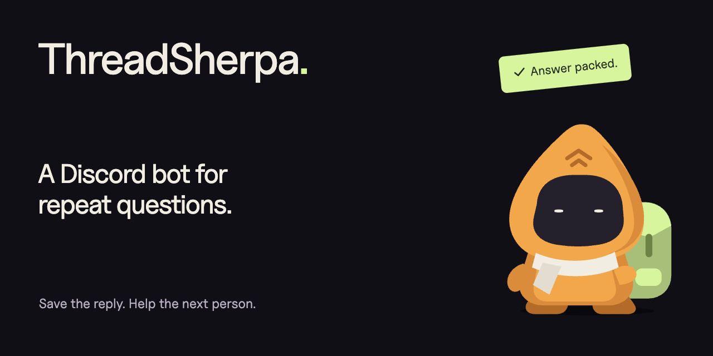
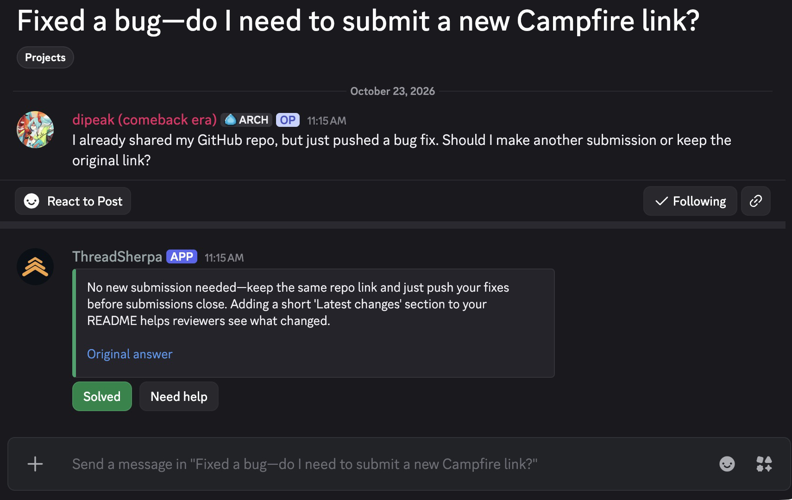
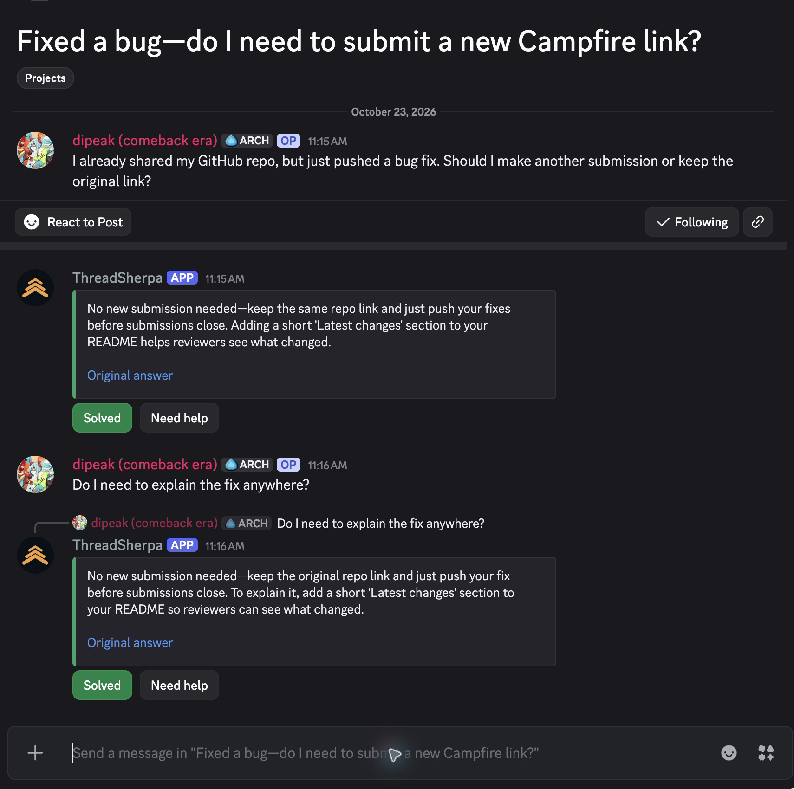
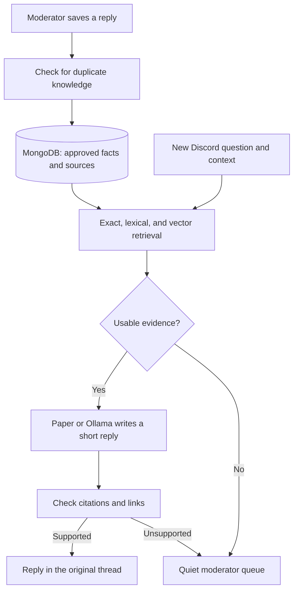

# ThreadSherpa



A Discord support bot that remembers the useful answer and helps the next person asking the same thing.

I built it after seeing repeated support questions in the **MLH Discord**. Account names, missing offer codes, student benefits: different people needed the same information, but the answer was often buried in another thread. Moderators should not have to do that lookup every time.

ThreadSherpa keeps the human answer as knowledge. An LLM writes a short reply for each new question, with a source. When the saved facts do not cover it, the bot stays quiet and leaves it for a moderator.

[Website](https://threadsherpa.onrender.com) · [Project artwork](https://threadsherpa.onrender.com/artwork/) · [Setup guide](docs/SETUP.md) · [GitLab mirror](https://gitlab.com/wdipak/threadsherpa) · [Security](SECURITY.md)

[](https://render.com/deploy?repo=https://github.com/sea-deep/threadsherpa)

The Render button deploys the website. The Discord bot runs separately. See [deployment options](docs/DEPLOYMENT.md).

## In Discord

A moderator replies normally, then right-clicks the message and chooses **Apps → Save this answer**. That save is the approval. Saving the same knowledge again does not create another copy.


A new post can ask the same thing in different words. ThreadSherpa uses the saved facts to write a fresh reply, rather than pasting the old message.



<details>
<summary>Follow-ups stay in the same conversation</summary>

The bot reads the thread context. A clear “that worked” can resolve the case quietly. Failed advice is kept for a moderator, so it does not repeat the same suggestion.



</details>

These captures show the working bot in a Campfire test server. The replies used Paper Instruments and saved knowledge in MongoDB Atlas.

## Run the bot

Requires Node.js 22+, MongoDB, and [Ollama](https://ollama.com/download). The [setup guide](docs/SETUP.md) has the Discord and Atlas links, permissions, and forum-channel steps.

```bash
npm ci
cp .env.example .env
```

Add your values to `.env`:

```env
DISCORD_BOT_TOKEN=your_bot_token
MONGODB_URI=your_mongodb_connection_string
MODEL_PROVIDER=ollama
```

Pull the local models, check the setup, and start:

```bash
ollama pull gemma4:e4b-it-qat
ollama pull embeddinggemma-2:270m
npm run setup
npm run dev
```

For Paper synthesis, set `MODEL_PROVIDER=paper` and `PAPER_INSTRUMENTS_API_KEY`. Ollama still supplies local embeddings and duplicate checks. Paper requests use API credit.

From a regular text channel, connect your support forum:

```text
/setup channel:#support autonomy_mode:auto
```

Then save the first useful moderator reply. You do not need an Atlas project ID or a separate Discord application ID.

## What runs



Knowledge is scoped to the server and can be edited, removed, or given an expiry. Atlas Vector Search is optional; small deployments can rank stored vectors in the app. Only moderator-selected documentation URLs can supplement memory. There is no open-ended web search.

## Commands

| Command | Use |
| --- | --- |
| `/setup` | Connect a channel, choose a moderator role, and set reply behavior. |
| `/ask` | Ask explicitly instead of waiting for automatic replies. |
| `/teach` | Save knowledge when there is no existing answer message. |
| `/memory` | Browse, add, edit, or import saved answers in a private moderator panel. |
| `/answers` | Find or remove saved guidance. |
| `/queue` | Review waiting questions and repeated gaps. |
| `/stats` | View questions, confirmed solves, and handoffs. |

## Development

```bash
npm run typecheck
npm test
npm run build
```

`npm run demo` runs a fixture-based flow without Discord or paid inference. `npm run verify:atlas` checks persistence and real vector queries using temporary synthetic records. Generated reports stay local.

The Astro website lives in `website/` and needs Node.js 22.23.4 or newer:

```bash
npm ci --prefix website
npm run dev --prefix website
npm run check --prefix website
npm run build --prefix website
```

The homepage conversation is an authored explanation of the bot. The separate `/try/` sandbox uses isolated guided state unless its API is configured for live mode. Neither needs the real Discord bot's credentials.

## About this project

Built for the [Hacktoberfest Open-Source AI Challenge: Week 3](https://dev.to/challenges/hacktoberfest-week3-2026-10-19) on DEV. The theme, **Slow and Steady**, asks for open-source AI that does work so you do not have to. Repeating fewer support answers is the small piece of work this project takes on.

This is an independent hackathon project inspired by the MLH community. Expect rough edges. The open model path uses Gemma through Ollama; you can inspect the prompts, change the behavior, and keep synthesis local. Discord and Atlas still require network access.

Apache-2.0. See [LICENSE](LICENSE).
