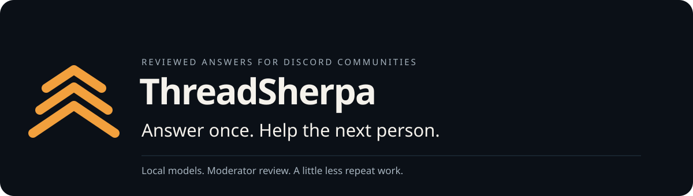

<p align="center"></p>

A Discord bot that turns a moderator’s answer into something the next person can find.

I started ThreadSherpa after seeing repeated questions in the MLH Discord: account names, missing offer codes, student benefits. Each member needed help, but moderators kept doing the same lookup. ThreadSherpa gives that work somewhere to stay.

**Answer in the post → right-click → save once → tailored replies to new questions.** Saved knowledge supplies the facts; the LLM writes for each asker. Unknown questions wait quietly for a human. Each asker can confirm when their question is solved.

**[Your minimum setup guide](docs/START_HERE.md)** · [Try the local demo](#try-it-in-a-minute) · [Set up Discord](docs/SETUP_DISCORD.md) · [Record a demo](docs/DEMO_SCRIPT.md) · [Week 3 entry plan](docs/CHALLENGE_STRATEGY.md)

## What makes it useful

- **A quieter support forum.** Opt in specific channels. Answer new posts automatically, or reply only when asked. Ordinary moderator chat never becomes training data.
- **Short, personal replies.** The LLM answers each new supported question in 1–3 sentences, with a source link and **Solved / Need help** buttons.
- **Save once.** Right-click a human answer → **Apps → Save this answer**. It saves immediately. Existing knowledge is skipped; no second approval or broadcast.
- **Keep knowledge current.** `/answers` opens a compact menu. **Edit** updates facts, question patterns and scope; **Remove** stops future use. `/teach` also accepts optional expiry.
- **Follows the conversation.** A clear “that worked” closes the asker’s question quietly. “That didn’t work” preserves the attempted advice for a moderator; the bot does not repeat it automatically.
- **Spots repeat gaps.** `/queue` groups similarly worded unanswered posts and shows their counts, while keeping every question separate.
- **Quiet when unsure.** Unsupported questions wait in `/queue`. Members confirm solves; `/stats` shows questions, solves and open handoffs.

## Try it in a minute

Node.js 22 or newer:

```bash
npm ci
npm run demo
```

This runs the real repositories, save workflow, orchestrator, and answer policy with a **scripted fixture provider**. It sends no Discord messages and needs no API keys, database, or model. It demonstrates behavior, not AI quality or production persistence.

For the same scenario with real local inference:

```bash
ollama pull gemma4:e4b-it-qat
ollama pull embeddinggemma-2:270m
npm run demo:live
```

The [demo script](docs/DEMO_SCRIPT.md) explains the expected behavior and the limits of the measurements. All demo community answers are synthetic, not MLH policies or benefit guarantees.

## Run your own bot

Follow [Your minimum setup](docs/START_HERE.md) for direct links and steps. For free normal operation, fill **the Discord bot token and Atlas connection string**, and use `MODEL_PROVIDER=ollama`. Paper is optional and uses API credit. The application ID is detected automatically.

```bash
npm ci
npm run setup
npm run dev
```

The checker preserves your existing `.env`, checks access without posting messages or paid inference, and prints the bot invite URL. Invite the bot before starting it. One-server setups register slash commands directly in that server.

In Discord, run setup from a regular text channel and select your support forum:

```text
/setup channel:#ask-community autonomy_mode:auto
```

Answer a sample forum question as a moderator, then right-click your reply → **Apps → Save this answer**. That’s it. The next question gets an LLM-written answer grounded in that knowledge. Saving never posts to older questions. `/teach` remains a manual-entry fallback.

Modes are **on request** (`supervised`, default), **automatic** (`auto`), or **quiet** (`observe`: record new forum posts without replying). Follow-ups update the original asker’s question; on-request mode only automatically replies when a requested detail was pending. Only configured support channels are monitored; `/ask` is an explicit request and works elsewhere in the server.

The old `MODEL_PROVIDER=hybrid` setting remains an alias for local Ollama. Use `MODEL_PROVIDER=paper` for the Paper + Gemma split described below.

## Website

The homepage shows the support conversation and the actual retrieval, model, and policy path. It has no model credentials or live Discord connection.

```bash
npm ci --prefix website
npm run dev --prefix website
```

The website requires Node.js 22.23.4 or newer. [Website details](website/README.md) · [GitHub](https://github.com/sea-deep/threadsherpa) · [GitLab](https://gitlab.com/wdipak/threadsherpa).

## Commands

| Command | Who | Purpose |
| --- | --- | --- |
| `/ask question` | Members | Find a supported answer |
| Right-click → Apps → **Save this answer** | Moderator | Save knowledge immediately; skip duplicates |
| `/teach question solution` | Moderator | Manual fallback; optional scope, source and expiry |
| `/answers query` | Moderator | Choose an answer, then Edit or Remove |
| `/queue` | Moderator | Open questions waiting for a reviewed answer |
| `/stats` | Members | Questions, solves and open handoffs |
| `/sources` | Members | Exact documentation pages selected by moderators |
| `/setup` | Administrator or configured moderator | Support channels, moderator roles, reply mode and optional source page |

Members use **Solved** and **Need help** on answer cards. There are no case or knowledge IDs to copy.

## Open where it matters

The free default is `MODEL_PROVIDER=ollama`. With `MODEL_PROVIDER=paper`, Ultramarine handles evidence-based synthesis through the OpenAI SDK; Gemma checks duplicates and supplies embeddings locally. With `MODEL_PROVIDER=ollama`, Gemma also handles synthesis. You can inspect the prompts and policy, host the model yourself, or swap the provider. When embeddings fail, ThreadSherpa falls back to keyword search; it never fabricates replacement vectors.

With Ollama mode, **inference** can stay on your machine. Paper mode sends support evidence and questions used for synthesis to Paper Instruments; it is not a fully local privacy mode. Discord still needs an internet connection. MongoDB can be local or hosted; optional documentation fetching and Sentry contact their respective services. Local inference has hardware and electricity costs even when it has no per-call API bill.

## Paper Instruments + Gemma

Copy `.env.example`, set `MODEL_PROVIDER=paper`, and add `PAPER_INSTRUMENTS_API_KEY` to your local `.env`. `PAPERINSTRUMENTS_API_KEY` is also accepted. The key is never borrowed from another provider. Ollama still checks duplicates and supplies embeddings; Paper is never asked for an unsupported embedding model.

```bash
npm run demo:paper -- --report data/paper-demo-usage.json
```

This sends synthetic support evidence to Ultramarine and runs Gemma locally. The report contains returned token counts and an estimated USD cost using [Paper’s published rates](https://docs.paperinstruments.com/docs/ultramarine/billing). Cached input and reasoning tokens are subsets, so neither is counted twice. Missing usage is left unmetered. The report is not an invoice or proof that an unrun integration works.

Reasoning effort defaults to `low`, with a 4,096-token ceiling including reasoning. Set `PAPER_REASONING_EFFORT` or `PAPER_MAX_COMPLETION_TOKENS` to tune that tradeoff. SDK retries are disabled; invalid or truncated output goes through the existing safe failure path. Every supported question, including exact repeats, uses the selected model to write its reply.

See [Paper setup and evidence](docs/SETUP_PAPER.md).

## Focused sources

Reviewed community answers come first. Optionally add up to three exact official documentation pages with `/setup source_url:https://…`. The bot reads at most two of those pages when needed. `/sources` shows the list. There is no autonomous web search, GitHub publishing or incident detection.

## Persistence and integrations

MongoDB stores questions, reviewed answers, versions, reviews, and run records. **`memory://` is temporary and loses data on process exit.** A configured MongoDB connection failure stops startup instead of silently discarding durability. `npm run setup` checks the connection before you start the bot.

Atlas Vector Search is optional: use the [index definition](docs/atlas-vector-index.json) for `knowledge_items`, named `vector_index`. Without it, the repository ranks stored vectors with cosine similarity in application memory. This fallback is for small communities; index-backed search is the scaling path. Exact question lookup currently scans the server’s approved items.

Sentry is optional. It traces investigations, model requests, and tools using `gen_ai` operations, with numeric token counts when the provider returns them. Prompts and message bodies aren’t intentionally included in spans. [Tracing notes](docs/OBSERVABILITY.md).

Render’s [worker blueprint](render.yaml) needs MongoDB and a reachable, separately hosted model endpoint. It does not run Ollama inside the worker. A blueprint alone is not a deployed integration.

## Checks

```bash
npm test             # deterministic tests; no model service required
npm run typecheck
npm run build
npm run test:live    # opt-in Ollama checks
npm run eval:paper   # real Paper + local embeddings, synthetic questions; uses API credit
npm run eval:local   # same small evaluation with local inference
npm run verify:atlas # real Atlas process-restart and vector search check; removes its synthetic records
```

The in-process learning test exercises saving, deduplication, synthesis, and correction. It does **not** prove persistence across a process restart. For a durable deployment, use Atlas and run `npm run verify:atlas` for a separate-process persistence and vector-query check. The [recorded free Atlas setup](docs/ATLAS_SETUP.md) includes actual database verification results.

## Boundaries

Account changes, payments, and credentials need a human. “Need help” marks the case for review; it does not page a staffed help desk. Only the asker or a moderator can change a case. Reviewed knowledge is shared within its server, so moderators should save reusable public guidance rather than private account details.

Citation validation checks that a source was retrieved; it cannot prove every generated claim follows from that source. Model-generated paraphrases can still retrieve the wrong answer. The regression suite and [synthetic model evaluation](docs/EVALUATION.md) are not a broad accuracy guarantee.

[Architecture](docs/ARCHITECTURE.md) · [Memory and review](docs/MEMORY_AND_LEARNING.md) · [Security](docs/SECURITY.md)

Built with AI assistance, including Antigravity and Codex, with the project author responsible for review and submission. Independent community project; not affiliated with or endorsed by MLH, DEV, or Discord.

Apache-2.0. See [LICENSE](LICENSE).
