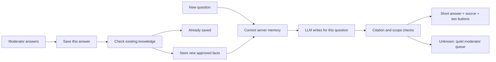

# Saved facts, personal replies

The router handles authorization, channel opt-in, and compact Discord responses. The orchestrator retrieves approved memory, optionally reads at most two exact moderator-selected documentation pages, and makes one synthesis request when evidence exists. Exact question matches skip retrieval embeddings, never response generation. Sensitive account operations bypass inference and web calls.

Local Ollama is the free default. Optional Paper mode uses Ultramarine for synthesis, local Gemma for duplicate checks, and local EmbeddingGemma for vectors. Run counts track orchestration requests; provider repair attempts can add requests.

Explicit moderator saves are approved immediately, deduplicated within the current server and compatible scope/expiry. Exact duplicates need no inference. Related facts are compared conservatively by the local model; uncertain checks save rather than discard knowledge. Each server’s saves are serialized within one process. Historical candidate records remain readable through legacy controls, but new saves have no draft step.

Every supported question gets an LLM-written reply grounded in current evidence. The full starter and follow-up context goes to synthesis. Similarity ranks evidence; it does not establish correctness. Expired, rejected and removed items are excluded, and each investigation clears older retrieved evidence. Citation validation checks provenance, not semantic entailment.

Unknown automatic questions and failed background checks are recorded silently. `/ask` is explicit and always returns a result. `/queue` lists only configured questions accessible to the moderator and bot. There is no copy-and-broadcast service, open web search, GitHub publishing or incident detector.

MongoDB stores questions, knowledge, versions, reviews, evidence, audit events and run metrics. Legacy sharing records are retained but unused. `memory://` is temporary. Atlas Vector Search is optional; small deployments can rank stored vectors in application memory. Exact lookup currently scans the server’s approved knowledge.

The original asker can confirm a solve in plain conversation. An explicit report that advice failed queues the question with the attempted answer, without another public response; a resolved case can reopen. Moderator retries include unsuccessful advice as context and reject an identical repeated answer. Waiting questions are grouped by similar wording within each support channel, after access checks. Topic groups do not merge cases or send bulk replies.
