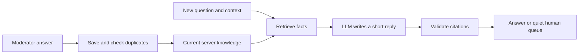

<!-- Local draft. Add repository and demo links, check the official submission template and category requirements, and review before publishing. -->

## What I built

I saw the same questions coming up in MLH’s Discord: missing offer codes, account names, student benefits. Each person needed help, while moderators kept repeating work they had already done.

ThreadSherpa makes that work last. A moderator answers normally, then right-clicks **Save this answer**. One action saves the knowledge. Repeated knowledge is skipped. The next person gets a short LLM-written reply tailored to their question, grounded in those saved facts.

The bot does not copy the moderator’s message into every thread. It keeps the source, considers the new question’s context, and replies in a few sentences. Unknown questions wait quietly for a human. Members can choose **Solved** or **Need help**.

## Demo

<!-- Add the actual repository link and a recorded Discord demo. -->

Show a moderator saving an answer, a repeated save returning “Already saved,” two new questions receiving different grounded responses, and a correction taking effect. Finish with an unsupported question waiting in the moderator queue.

`npm run demo` is a scripted plumbing demonstration. `npm run demo:live` uses real local inference on synthetic temporary-memory data. Neither is a recording of real community support, and sample answers are not MLH policies.

## How it works

Local Gemma checks related facts for duplicates and writes replies in the free Ollama mode. EmbeddingGemma supplies retrieval vectors. MongoDB stores knowledge, sources, versions and questions. Optional Paper mode uses Ultramarine through the OpenAI SDK for answer synthesis while keeping duplicate checks and embeddings local.

An exact saved question still goes through synthesis. The moderator’s wording is stored as evidence, not used as a response template. Scope, expiry and versioned edits keep knowledge useful; new investigations discard earlier retrieved evidence.

Saving is an explicit moderator action, not passive learning from every message. Duplicate checks are conservative: exact matches are skipped first, semantic matches are compared by the local model, and uncertain new facts are retained. These checks can still make mistakes. Citation validation establishes provenance, not proof of factual entailment.

## Why open inference matters

A community can run its model locally, inspect the prompts, and control where support evidence goes. Discord and hosted Atlas still require network services. Paper mode sends synthesis questions and evidence to Paper Instruments. The default bot uses local inference with no per-call API charge.

## What I removed

I removed broadcast sharing, the extra draft-review step, direct answer copying, GitHub automation, incident detection and open web search. The product became easier to explain: save useful knowledge once, then help each new person.

## Evidence and limits

The deterministic suite covers saving, duplicate detection, new facts, scope and server isolation, per-question generation, editing, citation policy and Discord authorization. Real local-model evaluations use synthetic data and developer-written expectations; they do not establish broad answer accuracy or real time saved.

A free Atlas M0 cluster and separate-process retrieval/vector-query checks establish durable knowledge storage. The current Paper flow passed 12/12 synthetic checks in data/evaluation-paper-current.json, with returned token usage and estimated cost recorded. Historical reports remain separate. No remote Sentry ingestion or Render deployment has been verified.

## Categories to support with the demo

Overall, Gemma, and MongoDB Atlas follow directly from the current flow. Ultramarine is optional and needs current usage/cost evidence. Only enter categories whose published requirements and challenge-window rules are met. No category entry has been submitted by this draft.

AI disclosure: I used AI assistance, including Antigravity and Codex, to build and refactor the project and prepare this draft. I am responsible for reviewing the implementation and final write-up.
