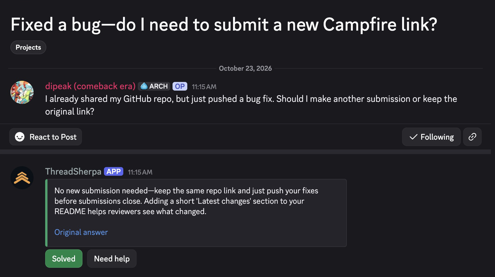
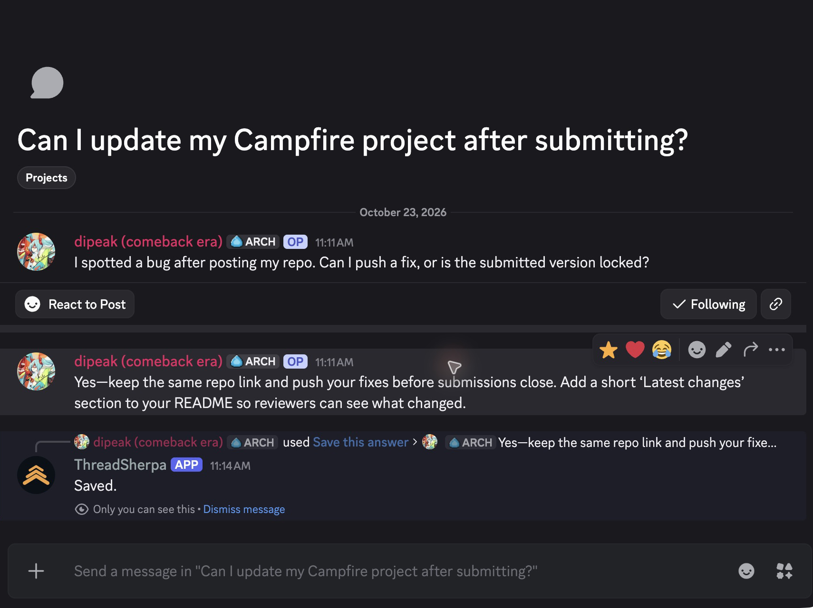

# Campfire screenshots

Captured from the actual Discord app on October 23, 2026. Campfire is fictional; the questions and moderator answer were posted from the project author’s account for this scripted walkthrough. ThreadSherpa generated the replies using Paper and saved knowledge in Atlas.

| File | Best use |
| --- | --- |
| [landing-hero.png](landing-hero.png) | Landing page: question, tailored answer, source and outcome buttons |
| [human-answer.png](human-answer.png) | Blog: the original moderator answer |
| [answer-saved.png](answer-saved.png) | Blog: one-action saving with the actual “Saved.” confirmation |
| [tailored-reply.png](tailored-reply.png) | Blog: a differently worded question answered from that knowledge |
| [follow-up.png](follow-up.png) | Blog: follow-up in the same conversation |
| [conversation-confirmed.png](conversation-confirmed.png) | Blog: “That worked, thanks!”; the case was verified as resolved |
| [forum-overview.png](forum-overview.png) | Product overview: forum posts alongside a support answer |

## Landing image

## Save once

## Conversation

These are crops of original screenshots. Message text, names, timestamps and bot output were not edited. The crops exclude unrelated server icons and surrounding desktop content. Full originals remain in the ignored `.local/captures/2026-10-23/` folder.

[Verification record](verification.json) · [Original human answer](https://discord.com/channels/1539567434673946655/1563064795471548487/1563064863368937543) · [Completed conversation](https://discord.com/channels/1539567434673946655/1563065868567580722)
